# studdy_plan_proyecto

# StudyPlan

**Equipo:** Diego Hernández Bautista y Kinberly Daniela Jaimes
**Carrera:** TSU en Desarrollo de Software Multiplataforma · Grupo GTID-243
**Asignatura:** Desarrollo de Aplicaciones Móviles · Universidad Tecnológica del Norte de Guanajuato (UTNG)

## 1. Descripción breve

StudyPlan es una app móvil hecha con Flutter para que los estudiantes del norte de Guanajuato organicen sus tareas, proyectos y fechas de entrega en un solo lugar. La verdad es que el problema que atiende es bien común: las actividades se quedan regadas entre la libreta, las notas del celular, el calendario y los grupos de WhatsApp, y por lo mismo de que no hay un sitio único donde ver qué falta, se olvidan entregas o se acumulan pendientes.

Cada tarea lleva materia, descripción, fecha de entrega, prioridad (alta, media o baja) y estado (pendiente o completada). Al marcar una tarea como completada el estudiante suma XP, y la app muestra su historial de logros escolares. Aparte de eso, la app tiene un rol de administrador (que gestiona las materias) y uno de tutor (un familiar que consulta el avance del estudiante en solo lectura), para un total de 3 tipos de usuario.

## 2. Los 3 tipos de usuario y sus dashboards

La app abre con un splashscreen y de ahi pasa al login, donde el usuario puede iniciar sesión o crear una cuenta nueva eligiendo su rol. Tanto el login como el registro validan los campos (el correo tiene que tener un formato válido, la contraseña mínimo 6 caracteres y, en el registro, hay que confirmar la contraseña y escribir el nombre). Una vez que la sesión está abierta, un enrutador por rol (`AuthGate`) manda al usuario a su dashboard, de modo que cada tipo de usuario ve solo lo que le corresponde.

**Estudiante.** Es el usuario principal de StudyPlan y el que organiza sus propias tareas. Su dashboard es la pantalla de Inicio, que muestra un saludo con su nombre, la lista de tareas pendientes ordenadas por fecha de entrega (cada tarjeta lleva la materia, el nombre de la tarea, su prioridad y la fecha) y un botón "+" para agregar una nueva. Con la barra inferior puede pasar a la pestaña de Completadas, donde ve su historial de tareas terminadas y el XP que ha acumulado. Su formulario es "Nueva tarea" (nombre, materia, descripción, fecha de entrega y prioridad), y al tocar cualquier tarea abre su detalle, desde donde la puede marcar como completada o eliminar. Las listas de pendientes y de completadas tienen su estado vacío para cuando todavía no hay nada que mostrar.

**Administrador.** Se encarga de mantener el catálogo de materias que después usan los estudiantes al crear sus tareas. Su dashboard es un panel de administración con el total de usuarios registrados (desglosado por tipo) y el total de materias, además de accesos directos a la lista de materias y al formulario para agregar una nueva. La lista de materias muestra cada una con su color y tiene estado vacío, y su formulario es "Nueva materia" (nombre y color), que no permite guardar nombres vacíos ni repetidos.

**Tutor.** Es un familiar que da seguimiento al avance de un estudiante, y por lo mismo de que solo consulta, no puede crear, completar ni borrar tareas (todo es de solo lectura). Su dashboard es un resumen del estudiante que tiene vinculado, con su nombre, cuántas tareas tiene pendientes y cuántas completadas, y su XP, y desde ahí puede entrar a la lista de tareas del estudiante y filtrarla entre pendientes y completadas. Si todavía no tiene a nadie vinculado, el dashboard muestra un estado vacío con el botón "Vincular estudiante", que abre su formulario: ahí escribe el correo del estudiante, y si no existe una cuenta de estudiante con ese correo la app lo avisa con un mensaje de error, no?

## 3. Manejo de estado elegido (y por qué)

Elegimos **Provider** con `ChangeNotifier`. La verdad es que lo escogimos por tres razones: es sencillo de entender para un proyecto de este tamaño, aparte de que no obliga a escribir mucho código extra (nomas se crea el provider, se registra en `MultiProvider` y las pantallas lo escuchan con `context.watch` o lo usan con `context.read`), y además nos permitió repartirnos el trabajo, ya que cada quien se encargó de sus propios providers sin pisarse con el otro.

Los providers de la app son:

| Provider          | Qué guarda 
| `AuthProvider` | Usuarios, sesión actual y rol (inicio de sesión, registro y cierre de sesión) |
| `MateriaProvider` | Catálogo de materias |
| `TareaProvider` | Tareas de los estudiantes (agregar, completar, eliminar y filtrar) |
| `VinculoProvider` | Relación entre cada tutor y su estudiante vinculado |

Así se cumple que el estado persista al navegar: el rol, las tareas y las listas se mantienen al cambiar de pantalla porque viven en los providers, no en cada pantalla.

**Limitación:** los datos se guardan en memoria, no en una base de datos. Mientras la app está abierta se conservan, pero al cerrarla se reinician a los datos de ejemplo. Para una versión futura se podría agregar almacenamiento local o un servidor, no?

## 4. Cómo ejecutar la app

**Requisitos**

- Flutter con Dart 3.7 o superior.
- Un emulador de Android o iOS, o un dispositivo físico (también corre en Chrome).

**Pasos**

```bash
# 1. Clonar el repositorio
git clone [URL-DEL-REPOSITORIO]
cd [CARPETA-DEL-PROYECTO]

# 2. Instalar las dependencias
flutter pub get

# 3. Ejecutar la app
flutter run
```

La única dependencia externa es [`provider`](https://pub.dev/packages/provider).

**Cuentas de ejemplo para probar los 3 roles** (contraseña de todas: `123456`)

| Correo | Rol |
|--------|-----|
| `sofia@demo.com` | Estudiante |
| `tutor@demo.com` | Tutor |
| `admin@demo.com` | Administrador |

También se puede crear una cuenta nueva desde la pantalla de registro. El tutor empieza sin estudiante vinculado, para poder probar el formulario de vinculación con el correo `sofia@demo.com`.

**Estructura de lib/**

lib/
├── main.dart
├── theme/          colores, tipografía y estilos compartidos
├── models/         Usuario, Materia, Tarea y Vinculo (más los enums de rol, prioridad y estado)
├── providers/      AuthProvider, MateriaProvider, TareaProvider, VinculoProvider
├── screens/        splash, login, registro, enrutador por rol
│   ├── admin/      dashboard, lista y formulario de materias
│   ├── estudiante/ inicio, nueva tarea, detalle y completadas
│   └── tutor/      resumen, lista de tareas y vinculación
├── utils/          validadores, mensajes y formato de fechas
└── widgets/        componentes reutilizables


## 5. Screenshots
### Splashscreen
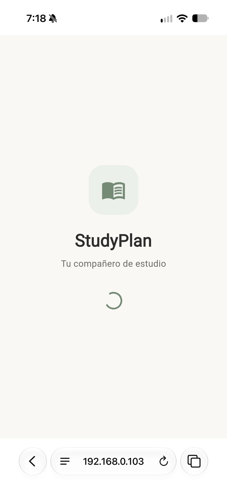

### Autenticación
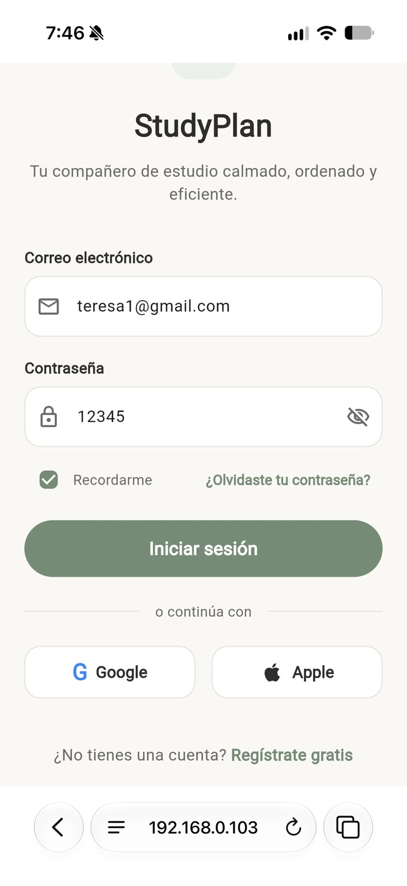
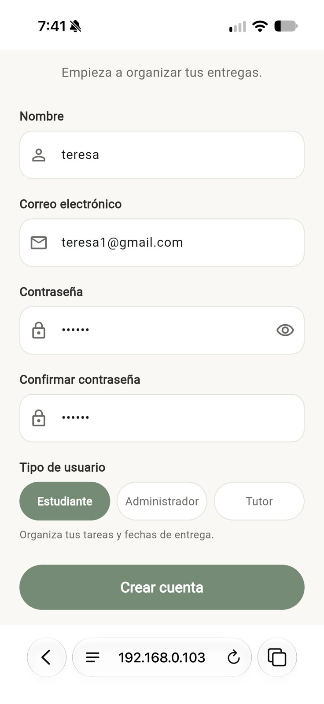

### Dashboards
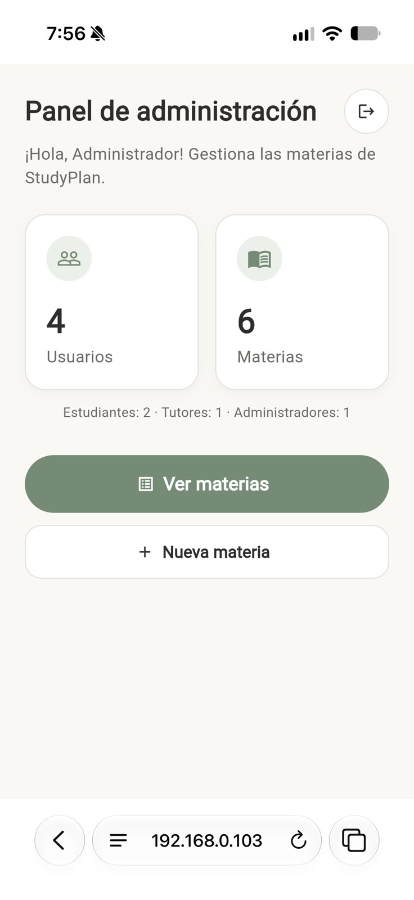
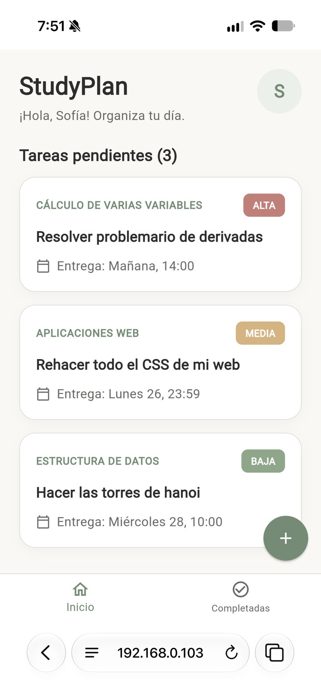
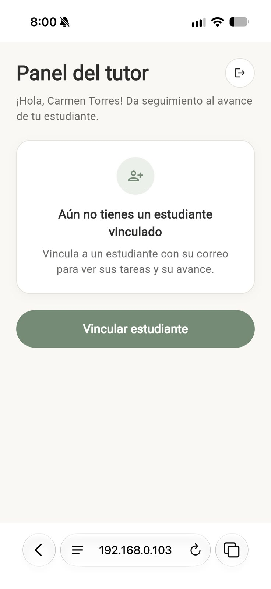

### Listas
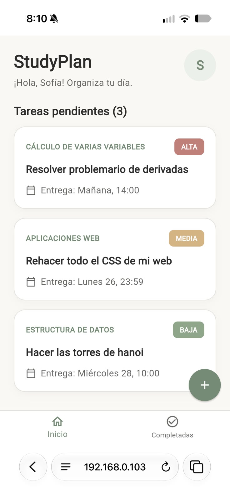
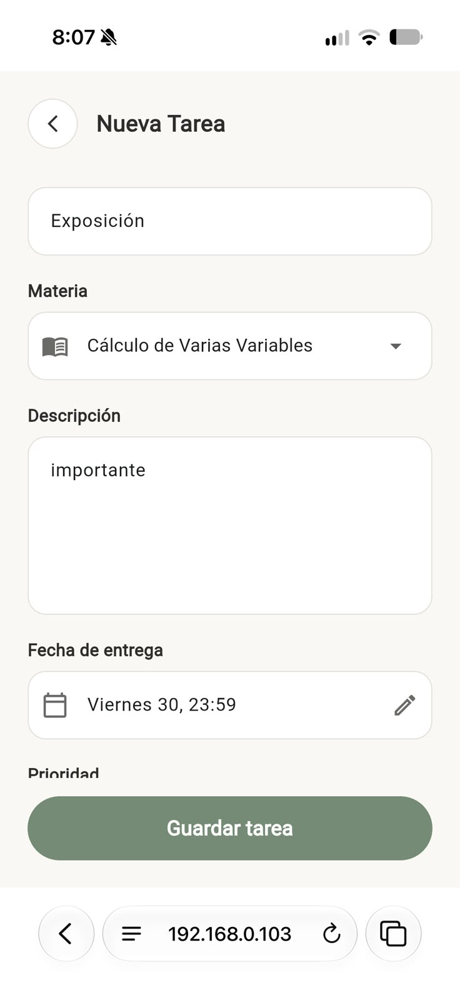
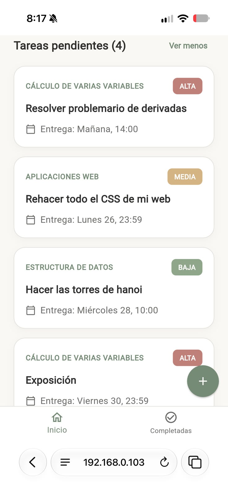

### Formularios
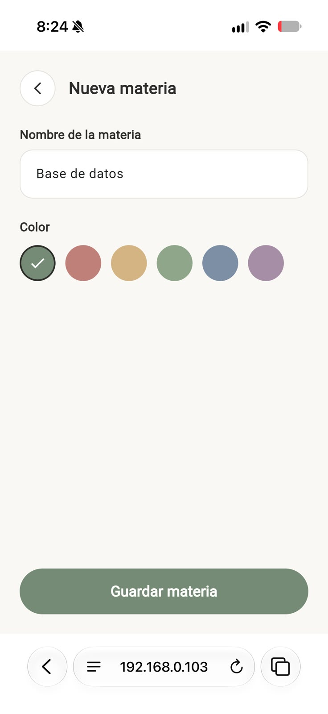

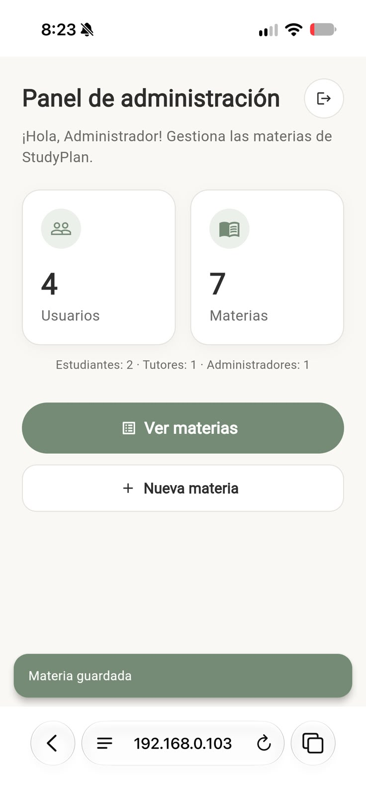

### Evidencia funcional
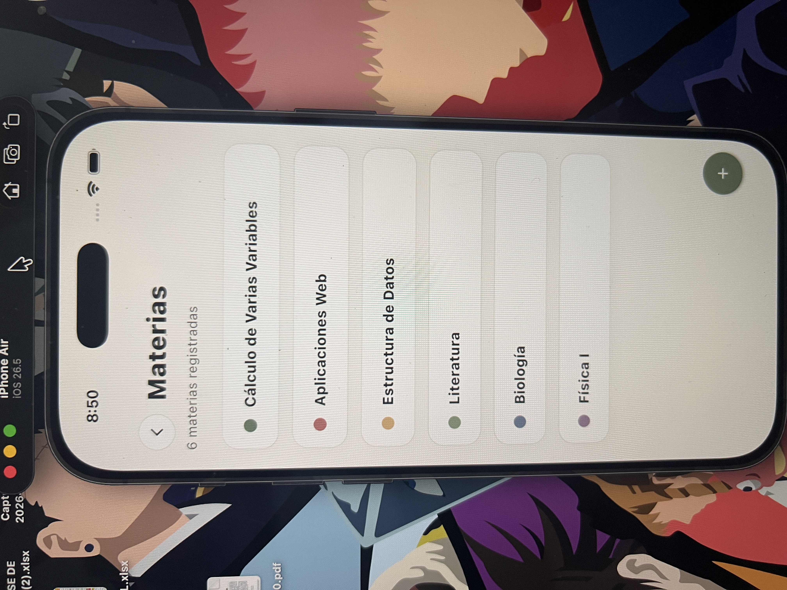
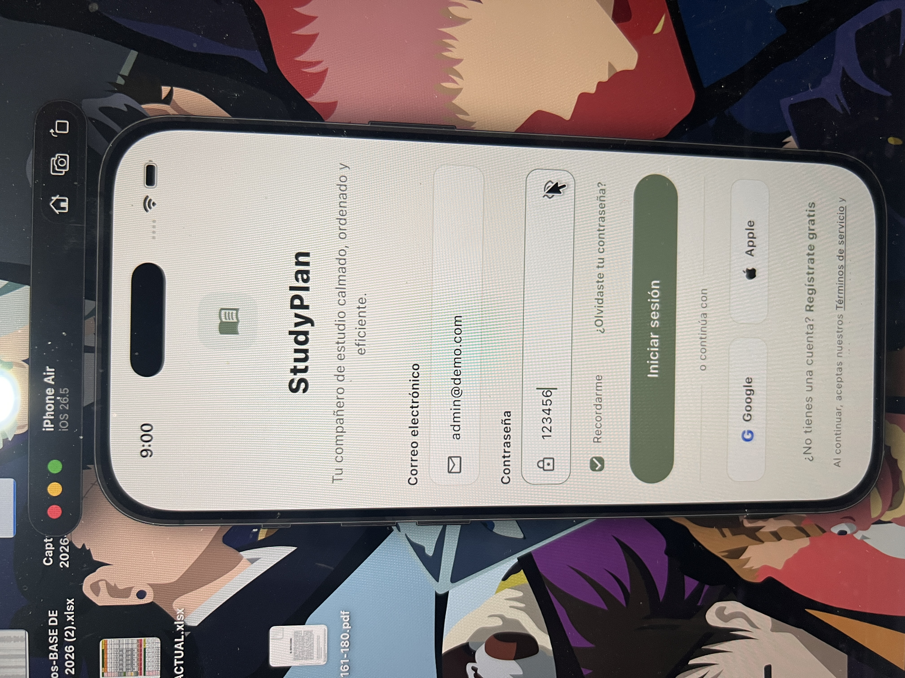 
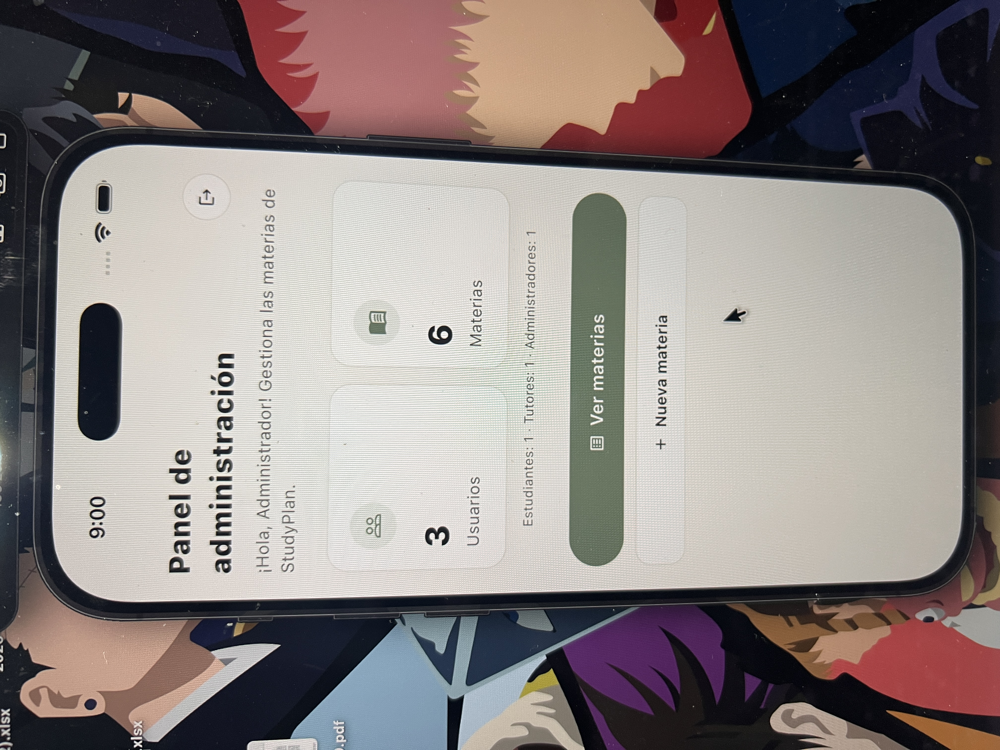 
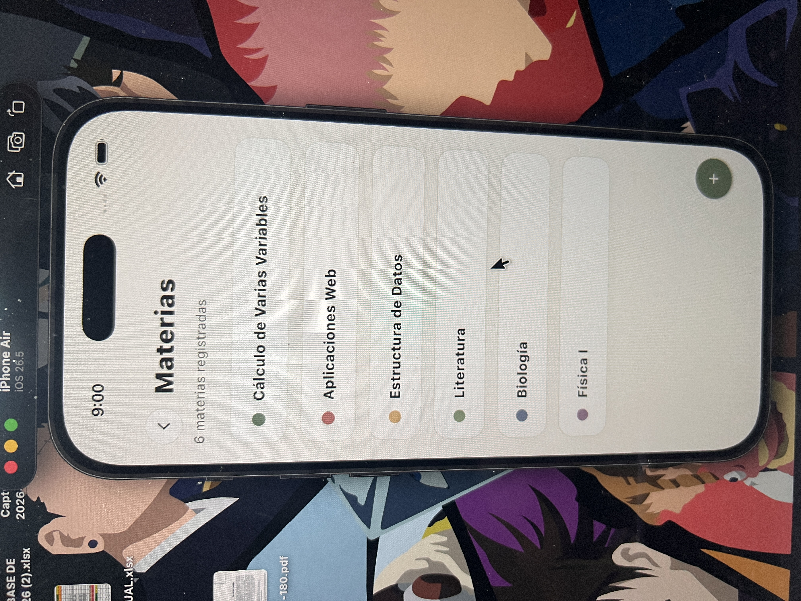
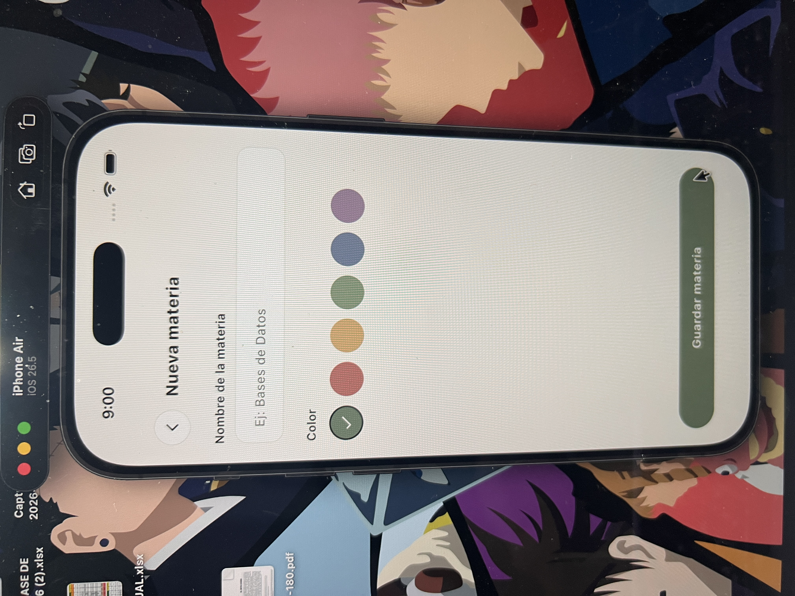
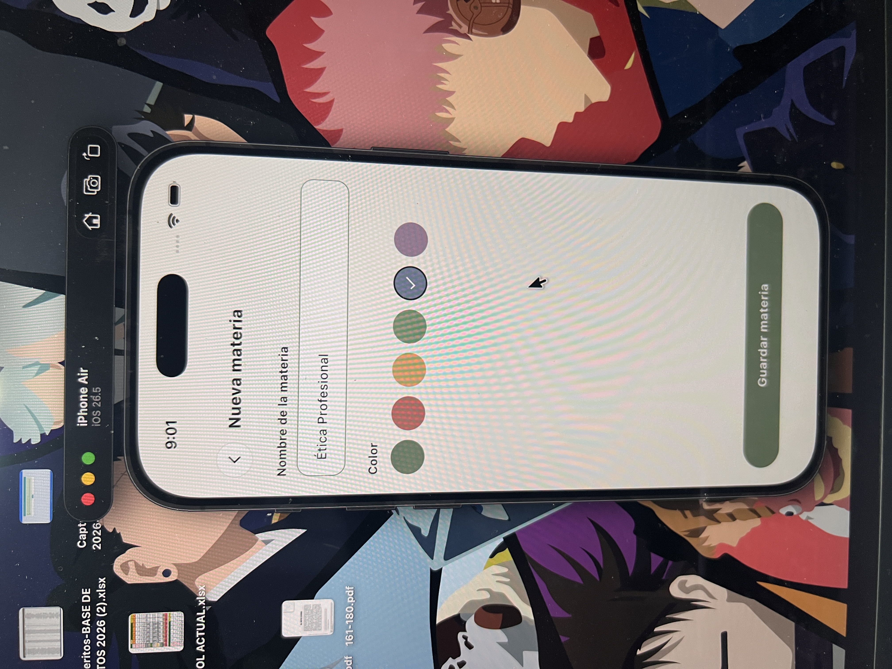
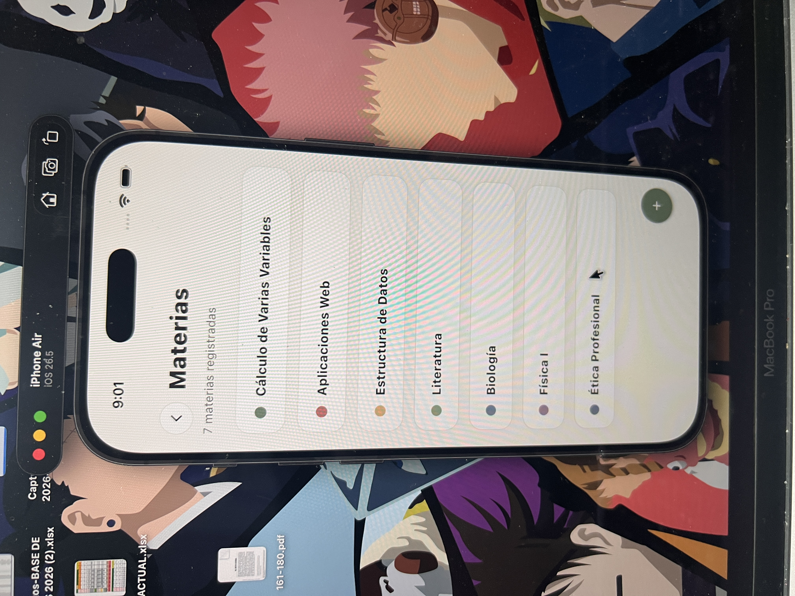