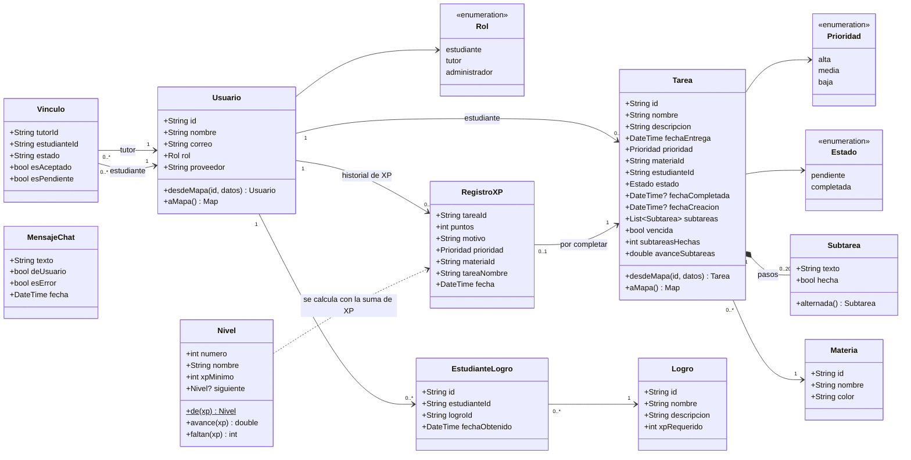
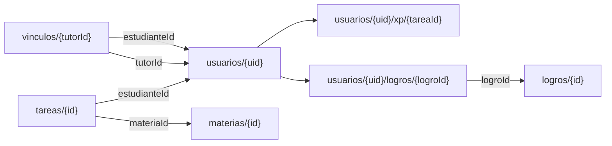
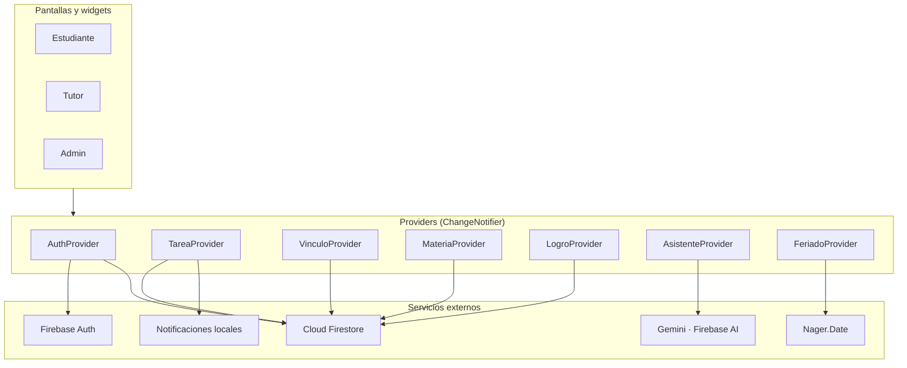
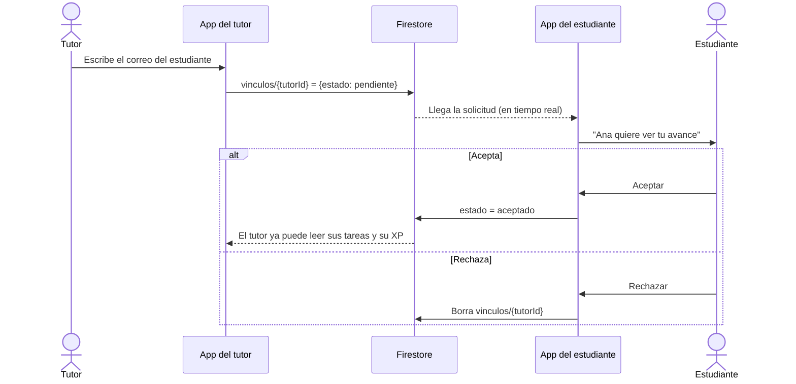

# StudyPlan · Diagramas

GitHub dibuja estos diagramas automáticamente (Mermaid). Si los abres en otro lado, pega el bloque en <https://mermaid.live>.

## Diagrama de clases (modelos)

Notas:
- Valores posibles: `Usuario.proveedor` es `correo` o `google`; `Materia.color` va en formato `#RRGGBB`; `RegistroXP.motivo` es `a_tiempo`, `tarde` o `muy_rapido`; `Vinculo.estado` es `pendiente` o `aceptado`.
- `Nivel` y `MensajeChat` **no se guardan** en Firestore. El nivel se calcula con el XP total, y la conversación del asistente solo vive mientras la app está abierta.
- Las subtareas se guardan **dentro** del documento de la tarea, en la lista `subtareas`.
- Un tutor tiene como máximo un vínculo, porque el id del documento es el del tutor. Un estudiante puede aceptar a varios tutores.

## Modelo de datos en Firestore

## Arquitectura (capas)

## Flujo: solicitud de tutor

